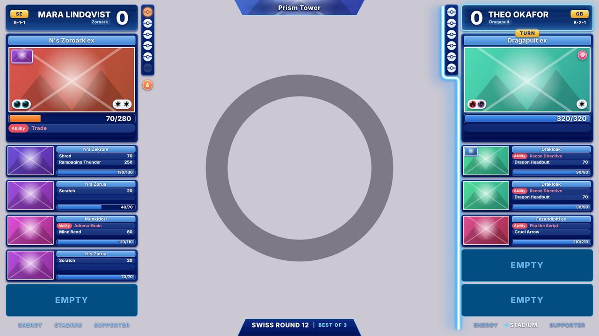
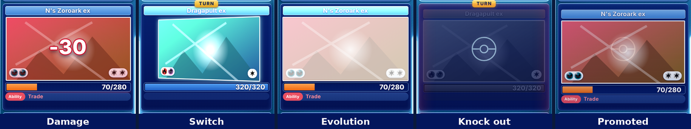

# Championship Blue

A design for a **top-down table camera**: two blue columns, one for each trainer, frame the table, the way big tournament streams do. The middle of the screen stays see-through, so put the camera under the overlay in OBS. Most of the look is drawn by the design's [style sheet](../../DESIGNING.md#style-sheet-and-animations), which also animates what happens in the match.

**It is OTO's default look:** it comes with the app and is on the overlay until you choose another design (Settings, Look). Its files are in [`assets/designs/championship-blue`](../../../assets/designs/championship-blue); this page describes them. To put it on another computer or back the way it was, Settings, Look, **Install a .oto**, and choose [`../championship-blue.oto`](../championship-blue.oto) (made from those files with `npm run pack:example`). Install the control settings too: they switch on the attacks of the Active and benched Pokémon, the turn highlight and the design animations (Settings, Overlay, *Design animations*), and switch off the toast banners at the bottom of the screen.

## What is where

Each column is a medium blue frame with a glossy rim. Its cards are stacked inside it, and while it is that trainer's turn a light bar, like a neon tube, runs down the side that faces the table.

| Place | What shows |
|-------|-----------|
| Each column, top | The header card: the trainer's name (two lines at most, then `…`), the games won in big white numbers on the side of the table, the country in a gold pill on the outer side with the record under it, and the deck in a small pill under the name. With an avatar, the avatar takes the outer side and the gold pill moves in |
| Next to the header | The prize cards, as six white balls (31 px) in a navy strip that sits in a bump of the frame. Each taken prize fades to gray on its own. A penalty marks the balls orange (no flag: the orange says it). A card put on a prize and shown face up shows the middle of its picture in the ball |
| Under the prize cards | The locks, which are the player's, only while they are on: ITEM LOCK or EVOLUTION LOCK is an orange ball with its picture (a crossed-out potion, a crossed-out evolution arrow). Its name comes out of the ball over the table for a few seconds when it is switched on, and again, struck through and gray, when it is switched off, before the ball goes. With no lock on, nothing is there |
| On the table, beside the prize cards | The discard pile and the Lost Zone (nothing while they are empty): navy cards like the prize strip with the last three cards fanned out, the name and how many, the Lost Zone with a violet rim |
| The Active card | A light-blue name bar, the picture in a white frame (attached energy bottom left, retreat cost bottom right, conditions top right, a Pokémon Tool as a little picture top left, as on the bench), the HP box, then navy rows with rounded ends: a red **Ability** pill and the ability's name in red (gray, with USED, once it is used), then the attacks with their damage. One empty row sits under the HP box, as on the original card; the first row covers it. Rows are 27 px high and get lower when two or three must fit. An empty Active card shows a faint ball |
| The bench | A card for each bench slot, each in a place of its own over five EMPTY plates: the picture in a white frame (attached energy bottom left, conditions top right, a Pokémon Tool as a little picture top left), the name bar, up to three rows (abilities, Tool names, attacks with their damage) and the HP bar across the bottom. An empty slot shows its EMPTY plate, so a knock out or a promotion never moves the rest of the bench |
| A bigger bench | A bench of 6 to 8 places stays inside the column: every card gets shorter (a band of the picture, the name, the HP bar, and the rows that fit: two with 6 places, one with 7, none with 8), and so do the EMPTY plates |
| Feature cards | While the producer shows them, they cover the bench of the trainer chosen for them: a navy card with a FEATURED name bar and the cards in white frames in the middle of it. Cards joined by a sign (`+`, `→`) are a stack, one over the other, with the sign on a navy ball between them |
| Each column, bottom | ENERGY, STADIUM and SUPPORTER (and the GX and VSTAR markers when they are switched on) in white capitals between two white rules |
| Top middle | The Stadium, in an angled navy tab that hangs from the top edge, with its name over a clear band of its picture (a soft shade behind the name keeps it readable). The tab shows only while a Stadium is in play |
| Bottom middle | The round and the best-of, in an angled navy tab that rises from the bottom edge, on the line of the footers. The tab goes when both are switched off |

The HP fill is blue while the Pokémon is healthy, yellow at half its HP or less and orange at a quarter or less, with the numbers in white on the right.

## The turn

The trainer whose turn it is gets a gold **TURN** tag between the header and the Active card, a bright cyan frame around the header card, the light bar down the column (the column of the trainer who waits has none), and a cyan glow around the Active picture. The tag no longer pushes anything (the style sheet places it), so the control settings switch the turn highlight on.

The footer says what that trainer has used this turn: a counter that is still free is white with a colored dot, a used one turns a quieter blue without its dot. The waiting trainer's footer is shown in light blue, all alike, without the dots: it does not say what they used on their last turn.

## The style sheet

`styles.css` comes after the classic look and restyles the whole overlay:

- **It places every piece.** The design has no layout entries: the header cards, the round tab, the prize strips, the Active cards, the benches, the feature cards, the footers, the locks, the TURN tags and the Stadium tab are where the style sheet puts them. Each column is 440 px wide at 10 px from the screen edge, and its cards are 424 px wide.
- **It draws the cards**: the navy cards with their thin light borders and scanlines, the name bars, the rows, the HP boxes, the EMPTY plates (drawn on the bench, so they go when the producer hides the bench), the prize balls, the tabs.
- **It takes the scoreboard apart** into the two header cards and the round tab.
- **It restyles the announcements.** The full-screen effects stay inside the camera window, between the light bars. Their titles are white capitals with a navy outline and a glow in the effect's color, and their second line is cyan. An attack's slash is the design's red, and its big damage number is not shown, since the Pokémon shows it and the line under the title says it. A knock out is a red glow at the edges of the window, a turn passed a blue band, a top deck gold, a victory a gold glow with confetti, a game start a navy wipe. The banner (when the producer switches the toast banners back on) is a card of the columns, low in the window, with its title in a light-blue name bar, and it rises into place. The shake of the whole overlay on a knock out is switched off (it lays the whole overlay out again at every frame, and it made the knock outs drop frames).
- **It animates the moments** (below).

The background picture (`images/backgroundImage.svg`) is only the frame of each column and the two white rules of the footer. The light bars are pictures of the style sheet, shown on the side of the trainer whose turn it is.

## Animations

The overlay marks what just happened in the match on the piece it happened to, for a *moment*: 1.3 seconds in this design (`--oto-moment-ms: 1300` in the style sheet). Each animation is shorter than that.

| Moment | What it does |
|--------|--------------|
| Damage | The picture shakes and flashes red, the amount (`-60`, white with a red outline) rises over it and stays readable for most of a second, and the HP box flares red |
| Heal | A green glow from the edges of the picture, and the amount (`+30`, green outline); the HP box flares green |
| Knock out | The Pokémon drains to gray and fades, most of the way in the first half; its picture shakes once and its column flashes red inside. The Active one sinks a little inside its card, a benched one into its own EMPTY plate. The tile stays for the moment (the style sheet names `moment-ko`), then goes |
| A Pokémon comes into the slot | On the bench it slides in from the outer edge of the column; in the Active card it rises into place (as a promotion from the bench). A light sweeps over the picture |
| Switch (the Active and a benched one change places) | The picture turns over, a light sweeps over it and the name bar flashes, on both tiles |
| Evolution | A white flash, the picture swells and settles, the name bar flashes |
| Going back a stage | A dim blue veil, and the picture shrinks a little |
| Energy attached | The energy pill pulses with a white glow |
| Pokémon Tool attached | Its little picture pops (on the Active card and on the bench) |
| Special condition | The icon of the condition that came pops (OTO's own icons: a moon, a flame, a spiral, a lightning bolt, a drop, a chain), and the picture takes its color for an instant (asleep indigo, burned orange, confused pink, paralyzed yellow, poisoned purple, trapped gray) |
| Ability used | The Ability pill flashes light pink and turns gray |
| Prize card taken | The ball grows with a glow, turns over and fades |
| Turn | The column's light bar lights up and a light runs down it, the header's frame flares and the TURN tag pops |
| Lock switched on or off | Its name comes out of the ball for three seconds; switched off, it is struck through and gray, and the ball goes after it |
| Turn counter or marker used | It pops with a glow and takes the quieter blue of a used one |
| Game won | The score jumps in gold |
| Stadium played | Its tab drops from the top edge and its name shines |

The animations work mostly with `transform`, `opacity` and `filter`, on what is inside the pieces the layout moves, never on the pieces themselves. With the design animations switched off, nothing plays and a knocked out Pokémon goes at once; the rest of the design stays.

## Colors

The colors are taken from the stream frames that inspired the design:

| Part | Color |
|------|-------|
| Column frame | Medium blue, `#0a609e` at the top to `#004a7c` at the bottom, with a light rim |
| Cards | Dark navy, `#05216f` to `#010f4f`, with faint scanlines and a light-blue border (`#9cc9ff` at the top) |
| Name bars | Light blue, `#7fb8ee` to `#3f84d6`, with white names |
| Rows | Navy, `#213f8a` to `#17337a`; the empty rows are a faint `rgba(46, 88, 170, 0.32)` |
| Ability, Tool | A red pill `#ea4f61` with the name in `#ff8b98`; the Tool's little picture has a purple rim `#9b6dff` |
| HP box | Navy with a `#7fb4ee` border; the fill blue `#4d9bf0` to `#1f60c6`, yellow `#ffe066` to `#e9b21d`, orange `#ffa04d` to `#ef6a12` |
| Country, TURN | Gold, `#ffe48a` to `#e3a321`, with navy letters |
| Locks | Orange, `#ff9f5a` to `#f2652a`, with a white rim and white letters |
| EMPTY plates | `#024e83` with a `#6cb9ec` border and `#66b6ea` letters, the color of the empty bench places on the original stream |
| Footer | White; used `#7fa9d6`; the waiting trainer's `#8fbfe6` |
| Light bar | A white core, a cyan band (`#8be3ff`), a blue glow (`#3aa6ef`) and a wide blue halo over the table |
| Moments | Damage `#d1102c` (the outline of the number), heal `#0f9a5a`, knock out `#ff3d55` |

The colors in `design.json` fill what the style sheet leaves to the classic look, such as the pause banner (`--bg-panel`, `--warning`), the orange of a penalty (`--danger`), and the dots of STADIUM and SUPPORTER (`--stadium`, `--supporter`). The font is the system's Segoe UI, or Inter, Helvetica Neue or Arial where it is missing: the design carries no font files.

## Limits

- **HP colors.** The overlay turns an HP bar yellow at half or less and orange at a quarter or less, and a design cannot change that. On the original stream any damage turns the bar yellow.
- **Rows.** The Active card shows up to three rows, a benched Pokémon's card up to three (fewer on a bigger bench): one more is cut off whole, never half. The Active card shows its attacks under its abilities when *Attacks of the Active Pokémon* is on (the control settings switch it on). A Pokémon Tool is a picture, not a row, unless the producer switches on the Tools by name.
- **The bench.** There are always five EMPTY plates, also when the bench is set smaller. A bench of six to eight has as many plates, shorter, all inside the column.
- **Abilities.** When an ability is used, every used ability of that Pokémon flashes: the overlay does not say which one it was.
- **The bench in a row** (a producer's option) does not fit the columns: the bench stays stacked.
- **Long trainer names** take two lines, then end with `…`. Trainer A's two-line names are lined up on the left, because the browser puts the `…` out of sight on a line lined up on the right.
- **Moving pieces in the editor.** The pieces sit where the style sheet puts them. The round tab belongs to the scoreboard, so moving or resizing the scoreboard in Layout moves the round tab with it (a resized scoreboard keeps its top edge in place). The turn frame around the header and the locks belong to the trainer's column, so they stay where they are when only the scoreboard or the Active card is moved.
- **The screen.** The design is for the wide 1920 × 1080 screen.

## Files

They are in [`assets/designs/championship-blue`](../../../assets/designs/championship-blue).

| File | What it is |
|------|-----------|
| `design.json` | The colors, the font, the HP box under the pictures, the crop of the Active picture (a wide band of the card's picture) and of the Stadium's |
| `styles.css` | The style sheet: where every piece goes, how the cards look, the announcements and the animations |
| `images/backgroundImage.svg` | The two column frames, with the bump that holds the prize strip, and the white rules of the footers |
| `images/css-glow-a.svg`, `images/css-glow-b.svg` | Pictures for the style sheet: the light bar of each column, shown while it is that trainer's turn |
| `images/prizeCardBack.svg` | The white ball of the prize cards |
| `images/css-ball.svg` | A picture for the style sheet: the faint ball of an empty Active card |
| `images/css-lock-item.svg`, `images/css-lock-evolution.svg` | Pictures for the style sheet: the crossed-out potion of ITEM LOCK and the crossed-out evolution arrow of EVOLUTION LOCK |
| `controls.json` | The control settings that go with it: the attacks of the Active and benched Pokémon, the turn highlight and the design animations on, the toast banners off |

`preview.png` and `preview-moments.png` are only for this page; they are not part of the package.

## How to change it

The quickest way is in OTO itself: Settings, Look, choose the design, **Edit the style sheet**. The overlay in the editor changes as you type, and **Try a moment** plays an animation without a match.

By hand: edit the files in `assets/designs/championship-blue`, then zip the **contents** of that folder and rename the zip to `.oto` (`npm run pack:example` does it for the example) (see [Making a design by hand](../../DESIGNING.md#making-a-design-by-hand)). The style sheet's numbers fit the frames of the background picture: the columns, their cards and the bump that holds the prize strip. If you move a card or change the width of a column in `styles.css`, move its frame in `backgroundImage.svg` too. The colors of the cards are custom properties at the top of the style sheet (`--chb-card`, `--chb-bar`, `--chb-hp-ok`...), so one change there changes every card. The moments the style sheet can animate are listed in [the design guide](../../DESIGNING.md#the-moments).
